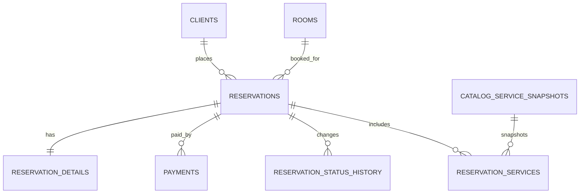
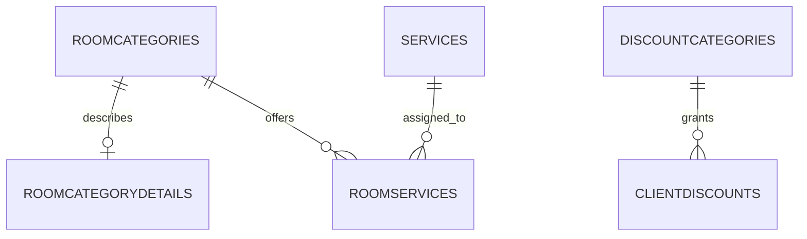

# Hotel Reservation System data model

## Service boundaries and ownership

| Service | Database | Owned data | Cross-service fields |
| --- | --- | --- | --- |
| Reservation | PostgreSQL `HotelReservationsDB` | Clients, rooms, reservations, payments, reservation details and status history | `catalog_service_id` is a logical Catalog reference. Service name/rate and room nightly rate are booking-time snapshots. |
| Catalog | PostgreSQL `HotelCatalogDB` | Room categories, category details, services, category-service links, discount categories | `clientId` in `clientdiscounts` is a logical Reservation reference and has no cross-database FK. |
| Reviews | MongoDB | Reviews, requests and discussions | `clientId`, `roomId` and `reviewId` are logical references. No Mongo document creates a cross-service database constraint. |

Copies are owned by the destination context. `Reservation.catalog_service_snapshots.name/price` and `reservations.room_rate_snapshot` are immutable snapshots captured when the reservation is made. Reviews and discussions retain IDs, not authoritative client or room records. The Aggregator cache is an expiring read copy; Catalog invalidates its local/distributed entries after catalog mutations and Reviews removes affected review keys after writes.

## Duplication and consistency policy

| Field or copy | Stored in | Authoritative source | Consistency policy |
| --- | --- | --- | --- |
| `catalog_service_id` | Reservation service snapshot | Catalog service ID | Logical reference only; no cross-database FK. The snapshot's name and price below are captured at booking. |
| `catalog_service_snapshots.name` | Reservation | Catalog service name | Immutable booking-time snapshot. Later Catalog edits do not rewrite an existing reservation. |
| `catalog_service_snapshots.price` | Reservation | Catalog service price | Immutable booking-time snapshot. The recorded charge remains auditable if Catalog changes its price. |
| `reservations.room_rate_snapshot` | Reservation | Reservation-owned room rate | Captured when the reservation is created; immutable for that booking. |
| `clientdiscounts.clientid` | Catalog | Reservation client ID | Logical reference used for discount assignment; Catalog does not own or edit the client record. |
| `reviews.clientId` and `reviews.roomId` | Reviews | Reservation context | IDs only. No client or room profile is copied into Reviews; a missing reference is handled at the application boundary. |
| Aggregator room/review result cache | Aggregator memory/Redis | Catalog, Reservation and Reviews | Expiring read copy. Catalog and Reviews publish invalidation events after writes; expiration bounds stale data if an event is missed. |

There is no independently editable copy of another context's authoritative data. Event-driven cache refresh/invalidation is eventual; booking snapshots are intentionally immutable.

## Reservation relational model



`reservation_services` is the junction table between reservations and locally stored catalog-service snapshots. `catalog_service_id` is intentionally not a foreign key to the separate Catalog database.

## Catalog relational model



`roomservices` implements the M:N relationship between room categories and services. `roomcategorydetails.categoryid` is both its primary key and FK, implementing 1:1. `clientdiscounts.clientid` references the Reservation context by identifier only.

The `roomservices` junction entity also owns `additionalprice`, a non-negative category-specific surcharge. This is relationship data, distinct from the base `services.price`, and is exposed with the category's service assignments.

## Index purpose

| Index | Intended query |
| --- | --- |
| `ix_reservations_client_checkin` | Active reservations for one client, newest check-in first. |
| `ix_reservations_room_dates` | Active reservations for a room over an overlapping date range. |
| `ix_reservations_status` | Reservations by workflow status, ordered by check-in date. |
| `ix_payment_reservation_date` | Payments for one reservation, newest first. |
| `ix_reservation_status_history` | Status changes for one reservation, newest first. |
| `ix_clients_active_email`, `ix_rooms_active_number` | Look up active clients by email and active rooms by room number. |
| Catalog `services.name` and `roomcategories.name` indexes | Support service/category name lookup and filtering. |
| Catalog unique `discountcategories.name` index | Prevent duplicate discount category names and support exact lookup. |

## MongoDB document examples

Collections: `reviews`, `requests`, `discussions`.

`reviews` and `requests` are independent documents. A discussion document combines references with embedded messages and allows optional fields to evolve:

```json
{
  "roomId": 101,
  "reviewId": "65a000000000000000000001",
  "subject": "Question about the room review",
  "messages": [
    { "clientId": 1, "text": "Is there a quiet place to work?", "createdAt": "2025-01-17T10:00:00Z" },
    { "clientId": 2, "text": "Yes, the room has a desk by the window.", "createdAt": "2025-01-17T10:05:00Z" }
  ],
  "moderation": { "state": "open", "labels": ["room-question"] }
}
```

`roomId` and `reviewId` are references; `messages` are embedded and limited to 100 per discussion; `moderation` is flexible metadata preserved in `Discussion.AdditionalData`. The idempotent seed example is [seed.example.js](../Services/Reviews/Reviews.Infrastructure/Seeding/seed.example.js). It includes collection indexing, optional JSON Schema validation and an example rating aggregation:

```javascript
db.reviews.aggregate([
  { $match: { isApproved: true } },
  { $group: { _id: "$roomId", averageRating: { $avg: "$rating" }, reviewCount: { $sum: 1 } } },
  { $sort: { averageRating: -1 } }
]);
```

## Recreating the databases

Reservation applies embedded scripts in numeric order. `001_schema.sql` creates the initial schema, `002_procedures.sql` defines transactional status operations, `003_seed.sql` inserts idempotent sample data, `004_room_rate_snapshot.sql` adds the immutable rate snapshot, and `005_audit_and_concurrency.sql` completes audit/soft-delete/version columns. Catalog uses EF Core migrations and seed data. Reviews creates indexes and inserts sample documents when the service starts; `seed.example.js` can also be run manually with `mongosh` against the configured Reviews database.
