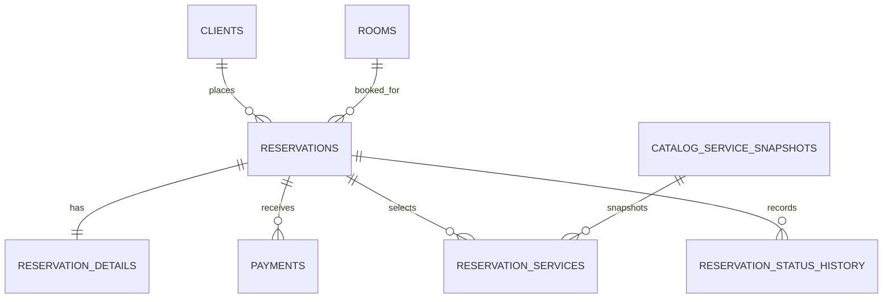
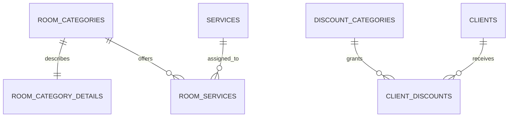

# Data model and context ownership

The platform separates booking transactions, hotel catalog data and guest-generated content. Each context owns its schema. Cross-context values are IDs and snapshots, never foreign keys.

## Reservation context — `db/p1/`

The reservation database owns clients, physical rooms, reservations, payment records, status history and booking details. Reservation and payment changes use a shared transaction. Soft deletion, audit columns and a version column support auditability and optimistic concurrency. Room rates and selected service prices are snapshots, so catalog changes do not rewrite existing bookings.

## Catalog context — `db/p2/`

Catalog owns room categories, category details, services, category-service assignments and discount definitions. `ROOM_SERVICES` stores the category-specific additional price. Client IDs in discount assignments are external identifiers; the Catalog database does not create a foreign key into Reservation.

## Reviews context — `db/p3/`

MongoDB stores reviews, guest requests and discussions. Reviews embed short author and room-display snapshots needed to render a document. Discussions are embedded with a review; room and category identifiers are references to other contexts. The collection validators and indexes are declared separately from the idempotent seed data.

## Duplication policy

| Value | Owner | Where copied | Update rule |
| --- | --- | --- | --- |
| Room category name | Catalog | Reviews display projection | Upsert on category create or rename event. |
| Service name and price | Catalog | Reservation service snapshot | Copy when selected for a booking; do not update existing booking history. |
| Room ID | Reservation | Review document reference | Store as an identifier only; no cross-database constraint. |
| Booking-time room rate | Reservation | Reservation row | Capture at booking creation; preserve after a later catalog price change. |
